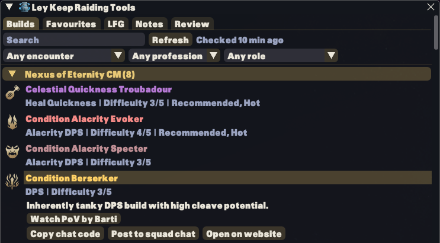
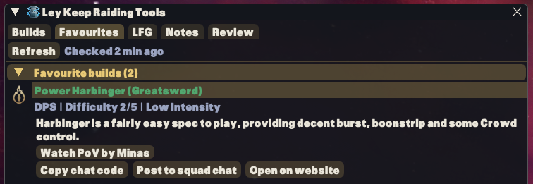
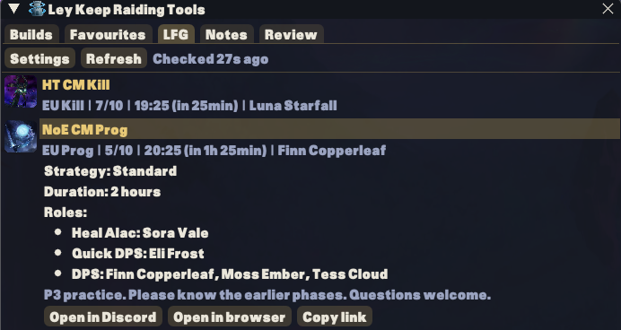
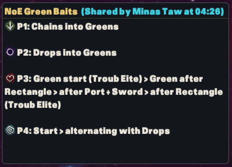
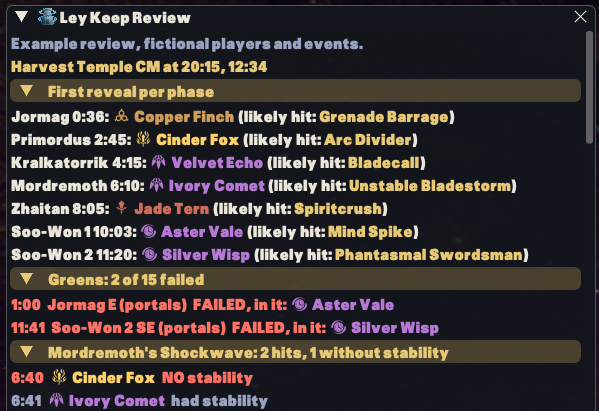

# Ley Keep Raiding Tools

A Guild Wars 2 addon available via Nexus with features focused on endgame PvE (CM & LM encounters). Features include Build previews from Ley Keep and Community Builds, a personal and squad note/cheatsheet system, instant post-pull mechanical reviews for supported encounters, and LFG listings (including alerts) from the Ley Keep Discord Server.

## Features

- Browse Ley Keep builds including some summary information, copy build chat codes, and direct links to the Ley Keep build page and corresponding PoVs, as well as a preview window of the build.
- Access your favourite builds, community builds, tier lists and squad compositions in game.
- Preview builds, tier lists and squad compositions in a movable, resizable window. Build previews show gear, traits and skills.
- Browse Ley Keep LFG runs and receive alerts for new runs that match your filters.
- Write notes that can be opened as personal note, or shared as squad note across the squad. Also features one-click squad message writing and sharing with squad chat.
- Instantly review supported encounter mechanics after a pull. Supported encounters are Harvest Temple, Temple of Febe, Greer, Decima, Ura and Nexus of Eternity, in Challenge or Legendary Mode.

You can choose which features to show/hide in the Ley Keep Raiding Tools addon window.

### Example screenshots

#### Builds

#### Favourites

#### LFG

#### Shared notes

#### Review

## Requirements

Guild Wars 2 and Nexus are required. Some functions have extra requirements:

- Accessing saved favourite builds/tier lists/squad compositions needs an addon token generated on your Ley Keep (https://leykeep.com/account) account page.
- Receiving shared squad notes needs ArcDPS Unofficial Extras. Squad members without it can still read the shared messages in the squad chat.
- Post-pull reviews needs arcdps logs.

## Installation

### Manual download

1. Install Nexus using its official instructions at https://raidcore.gg/Nexus.
2. Download [`ley_keep_raiding_tools.dll`](https://github.com/minas-gw2/ley-keep-raiding-tools-releases/releases/latest/download/ley_keep_raiding_tools.dll) from the latest release.
3. Close Guild Wars 2 and place the DLL in the game's `addons` folder.
4. Start the game, open Nexus > Addons > Installed and load Ley Keep Raiding Tools. The first opening includes a short setup guide.

### Nexus library

These steps apply once the addon is available in the Nexus library. Use the manual download above if it is not listed yet.

1. Install Nexus using its official instructions at https://raidcore.gg/Nexus.
2. Start Guild Wars 2, open Nexus > Addons > Library and search for "Ley Keep Raiding Tools". Click "Install".
3. In Nexus, go back into the "Installed" addons and then click "Load" to load Ley Keep Raiding Tools. The first time includes a short setup guide.

## Opening the addon

An icon is added to the top left menu bar (can be hidden in the settings). The default keybind to open the window is `Alt+Shift+R`, which can be changed in the settings.

General settings are under Nexus options > Ley Keep Raiding Tools. Notes and LFG have their own Settings buttons in the addon window.

Nexus keybind settings also have separate toggles for Personal note, Squad note, Review and Preview. They start unassigned so you can choose keys without replacing existing bindings. Personal and squad note shortcuts reopen the last available note from this session. The Preview shortcut reopens the last preview with the normal freshness and access checks.

Note windows have an X on their title bar, or a Close button below the content when the title bar is hidden. Locked notes stay click-through and can be hidden with their window keybind.

## Behavior and policy disclosures

- **Memory Access.** The addon reads Mumble Link shared memory and receives optional arcdps and Unofficial Extras events. The chat decoder from Unofficial Extras used for the Squad Note system uses Windows `ReadProcessMemory` to copy bounded callback buffers in the current game process.
- **Macro Usage.** The Squad Note system uses chat messages to sync Squad Notes. This can cover multiple chat messages with one click.
- **AI Notice.** AI-assisted code and documentation are part of development.

## Help and feedback

Join the Ley Keep Discord at https://leykeep.com/discord to report a problem or suggest new features.

## Credits

The Ura arena map in the Review feature is reused with permission from the [GW2 Elite Insights Parser project](https://baaron4.github.io/GW2-Elite-Insights-Parser/) | [GitHub repository](https://github.com/baaron4/GW2-Elite-Insights-Parser).

### Guild Wars artwork disclaimer

The addon uses Guild Wars 2 squad markers, profession and elite specialization icons, the Stun icon, and game imagery in setup screenshots. Public native previews also download GW2 reference data from ArenaNet's API and icons and specialization art from its render service.

Use of ArenaNet-owned content is subject to the [ArenaNet Content Use Policy](https://www.arena.net/en/legal/content-terms-of-use). This notice does not establish approval of the addon's behavior or permission for artwork owned by other creators.

© ArenaNet LLC. All rights reserved. NCSOFT, ArenaNet, Guild Wars, Guild Wars 2, GW2, Heart of Thorns, Path of Fire, End of Dragons, Secrets of the Obscure, Janthir Wilds, Visions of Eternity, and all associated logos, designs, and composite marks are trademarks or registered trademarks of NCSOFT Corporation. All other trademarks are the property of their respective owners.

---

> Ley Keep Raiding Tools is an unofficial community project and is not affiliated with or endorsed by ArenaNet or NCSOFT.
